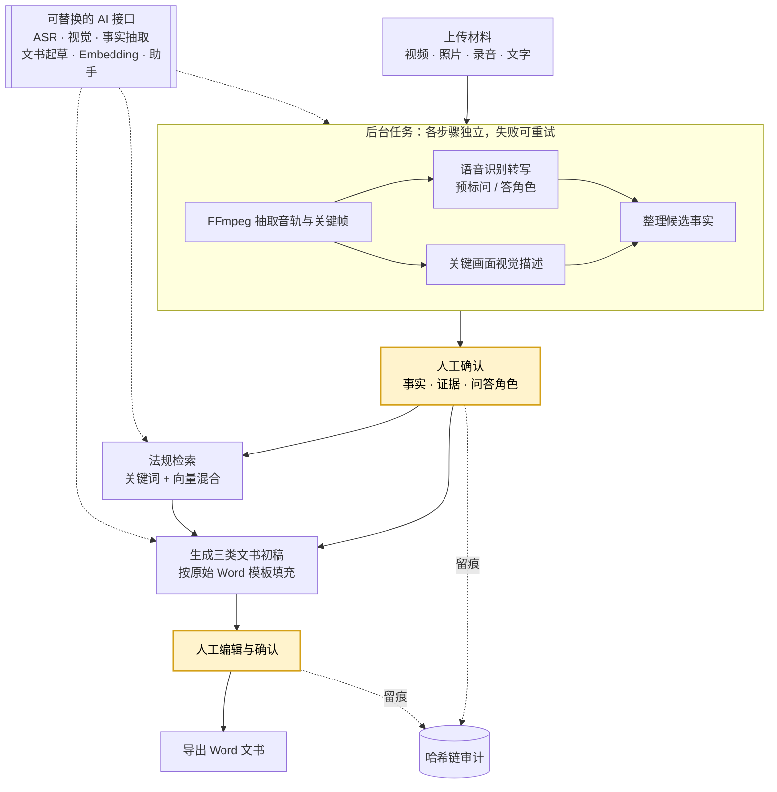

# 消防监督检查 AI 辅助系统

## 项目简介

面向消防监督检查的 AI 辅助系统：把一次现场检查产生的视频、照片、录音和文字说明，整理成可核对的事实与证据，再生成检查记录、照片类文书和询问笔录三类正式 Word 文书。AI 只产出候选内容，事实、问答角色、法规适用性和最终文书都由检查人员确认。



黄色为必须人工确认的环节；虚线表示 AI 能力接入和审计留痕。

### 核心流程

1. 创建一次检查，上传视频、照片、录音或文字材料
2. 后台用 FFmpeg 抽取音轨和关键帧（用感知哈希过滤重复画面），调用语音识别生成带时间点的转写，并由 AI 预标每段的“问 / 答”角色
3. AI 结合转写和画面描述整理候选事实，每条可关联视频时间段、关键画面、转写片段和法规条款，由人工确认、修改或排除
4. 法规知识库支持关键词与向量混合检索，回答附带原文和出处
5. 按单位原始 Word 模板生成三类文书：系统自动识别模板中的填写区域，识别不了的由管理员手动映射；导出时保持模板原有格式，人工修改过的内容默认不会被 AI 重新生成覆盖
6. 关键操作全程留痕，可查看操作人、时间和修改前后的值

### 设计亮点

- AI 能力可替换：语音识别、视觉、事实抽取、文书起草、Embedding 和助手六类能力均抽象为接口，每类单独配置端点、模型和密钥，更换模型厂商无需改动业务代码
- 全局 AI 助手：理解当前检查和页面上下文，可查询法规、定位证据；只返回经过权限校验的导航动作，任何修改、确认或删除都必须由用户显式操作
- 防篡改审计：审计记录以哈希链串联，PostgreSQL 触发器禁止修改和删除已有记录，可用 `verify_audit_chain` 校验记录是否被篡改

### 技术栈

- 后端：Python 3.12、Django、Django REST Framework、PostgreSQL（本地开发可用 SQLite）
- 前端：React、TypeScript、Vite、TanStack Query
- 媒体与文档：FFmpeg、python-docx、pdfplumber
- 部署：Docker Compose，单机构内网私有部署

### 工程质量

- 后台任务支持失败隔离和有限次重试，单个 AI 步骤失败不影响其他步骤
- 分层验收并已通过：单元 / API / 安全测试、真实 AI 端点、PostgreSQL 并发与备份恢复、Windows Word 文书视觉检查、浏览器 E2E
- 验收报告对每一项明确标记 PASSED / FAILED / NOT RUN，未运行的不计为通过

### 开发过程

项目以 PRD 和验收标准驱动：先打通关键链路，再让多个模型依据 PRD 各自生成完整实现并比较，选定一版后经过多轮调整和验收得到当前版本。早期版本保留在 Git 标签中。

## 本地开发

要求 Python 3.12、Node.js 22、FFmpeg/ffprobe、LibreOffice 与 Poppler。普通测试使用 SQLite 和固定响应，不需要真实 AI 或公网。

```bash
export UV_CACHE_DIR="$PWD/.uv-cache"
export FIRE_INSPECT_CSRF_TRUSTED_ORIGINS="http://127.0.0.1:5173"
uv sync --frozen --group dev
uv run python manage.py migrate
uv run python manage.py create_initial_admin
uv run python manage.py runserver
```

`create_initial_admin` 默认交互输入用户名，并通过隐藏输入读取、确认密码。自动化初始化时仅从显式指定的进程环境变量读取密码，例如：

```bash
uv run python manage.py create_initial_admin \
  --noinput \
  --username bootstrap-admin \
  --password-env FIRE_INSPECT_INITIAL_ADMIN_PASSWORD
```

请通过受保护的运行环境预先注入并在使用后清除该变量。命令不读取 `.env`，不提供默认账号或密码，也不会回显密码。

前端在另一个终端启动：

```bash
cd frontend
corepack enable
pnpm install --frozen-lockfile
pnpm dev
```

Vite 开发服务器使用 `http://127.0.0.1:5173`，所以上面的 Django 进程必须显式信任该本地 Origin；生产环境仍只配置实际的 HTTPS 同源地址。

系统没有默认账号、默认密码或生产密钥。真实 AI、真实视频和 Windows 文书验收必须通过显式测试入口运行。

## 测试入口

```bash
make fast
make local-acceptance
make real-ai
make windows-docx
make postgres
make browser-e2e
```

- `fast`：后端单元/API/安全/固定 AI/DOCX 结构，以及前端测试和构建。
- `local-acceptance`：显式使用本机授权视频与法规 PDF；不会把视频或关键帧复制进仓库。
- `real-ai`：只有四类端点环境变量齐全并显式授权时运行。
- `windows-docx`：在单位指定 Windows + Word/WPS + 字体环境运行。
- `postgres`：使用显式提供的隔离 PostgreSQL URL 验证双 Worker 领取、唯一约束和备份恢复。
- `browser-e2e`：使用系统 Chrome 访问已部署的 HTTPS 地址，阻断公网请求并验证登录、创建检查、材料上传和深层 SPA 路由刷新。

测试命令会把后端与前端 JUnit 写入 `test-results/`，并由精确测试节点生成
`test-results/acceptance-coverage.json`。报告对每条验收项及每个门槛明确标记
`PASSED`、`FAILED` 或 `NOT RUN`；文件存在本身不算证据，未运行也不能计为验收通过。
各外部门槛所需变量、审批文件和运行步骤见[配置说明](docs/CONFIGURATION.md)。

部署、配置、备份恢复与升级见 [部署说明](docs/DEPLOYMENT.md)、[配置说明](docs/CONFIGURATION.md) 和 [运维手册](docs/OPERATIONS.md)。
