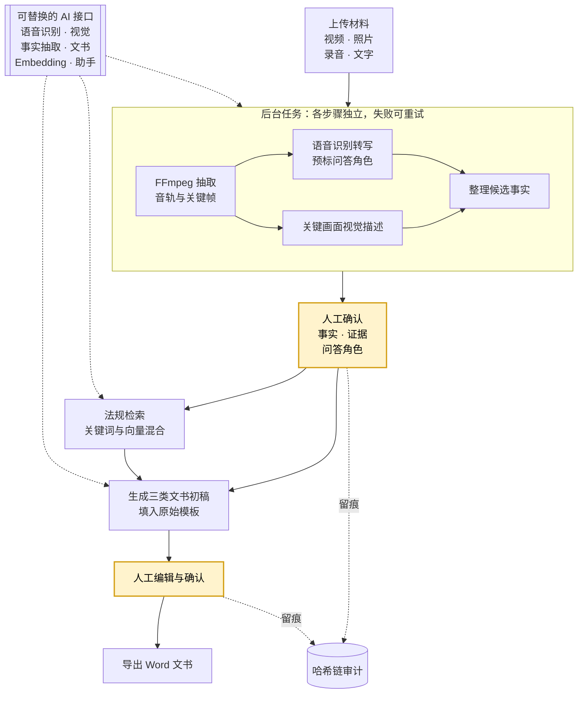

# 消防监督检查 AI 辅助系统

## 项目简介

面向消防监督检查的 AI 辅助系统：把一次现场检查产生的视频、照片、录音和文字说明，整理成可核对的事实与证据，再生成检查记录、照片类文书和询问笔录三类正式 Word 文书。AI 只产出候选内容，事实、问答角色、法规适用性和最终文书都由检查人员确认。



黄色为必须人工确认的环节；虚线表示 AI 能力接入和审计留痕。

### 设计亮点

- 证据可回溯：每条事实可关联视频文件的具体时间段、关键画面、转写片段和法规条款，核对时不用重看整段视频；关键帧用感知哈希过滤重复画面
- 保留单位模板：自动识别 Word 模板中的填写区域，识别不了的由管理员手动映射；导出保持模板原有格式，人工改过的字段默认不会被 AI 重新生成覆盖
- AI 能力可替换：语音识别、视觉、事实抽取、文书起草、Embedding 和助手六类能力均抽象为接口，每类单独配置端点、模型和密钥，更换模型厂商无需改动业务代码
- 全局 AI 助手：理解当前检查和页面上下文，可查询法规、定位证据；只返回经过权限校验的导航动作，任何修改、确认或删除都必须由用户显式操作
- 防篡改审计：审计记录以哈希链串联，PostgreSQL 触发器禁止修改和删除已有记录，记录操作人、时间和修改前后的值，可用 `verify_audit_chain` 校验是否被篡改

### 技术栈

- 后端：Python 3.12、Django、Django REST Framework、PostgreSQL（本地开发可用 SQLite）
- 前端：React、TypeScript、Vite、TanStack Query
- 媒体与文档：FFmpeg、python-docx、pdfplumber
- 部署：Docker Compose，单机构内网私有部署

### 工程质量

- 后台任务支持失败隔离和有限次重试，单个 AI 步骤失败不影响其他步骤
- 分层验收并已通过：单元 / API / 安全测试、真实 AI 端点、PostgreSQL 并发与备份恢复、Windows Word 文书视觉检查、浏览器 E2E
- 验收报告对每一项明确标记 PASSED / FAILED / NOT RUN，未运行的不计为通过

### 开发过程

项目以 PRD 和验收标准驱动：先打通关键链路，再让多个模型依据 PRD 各自生成完整实现并比较，选定一版后经过多轮调整和验收得到当前版本。早期版本保留在 Git 标签中。

## 快速开始

需要 Python 3.12、Node.js 22、FFmpeg、LibreOffice 与 Poppler。快速测试使用 SQLite 和固定 AI 响应，不需要真实模型或公网：

```bash
uv sync --frozen --group dev
pnpm --dir frontend install --frozen-lockfile
make fast
```

本地启动和各层验收入口见 [开发与测试](docs/DEVELOPMENT.md)；部署、配置和运维见 [部署说明](docs/DEPLOYMENT.md)、[配置说明](docs/CONFIGURATION.md) 和 [运维手册](docs/OPERATIONS.md)。
